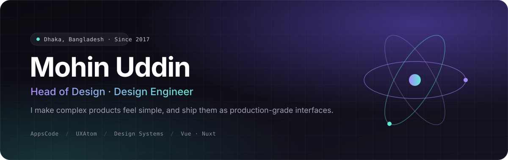
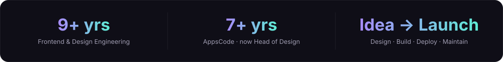
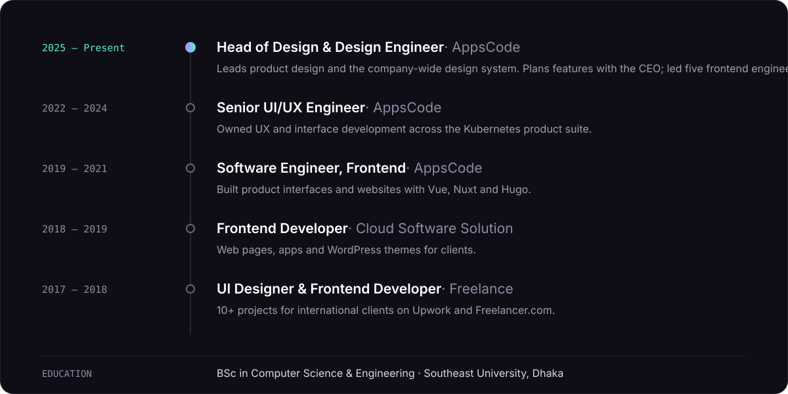
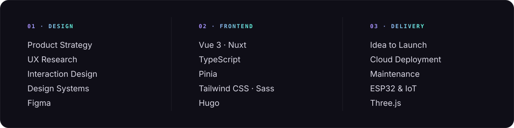

 

 

## About

I lead UI/UX design at **[AppsCode](https://appscode.com)**, where I shape the experience of a cloud-native Kubernetes product suite and own the company-wide design system. My work sits where design and engineering meet: I research, design and prototype in Figma, then ship the same ideas as production Vue and Nuxt components.

Outside AppsCode, I run and maintain **[UXAtom](https://uxatom.com)**, my independent product studio. There I take ideas from first sketch to deployed product, across web, desktop, mobile and hardware.

 

## Products · UXAtom

Independent products I design, build, launch and maintain.

<table>
  <tr>
    <td width="50%" valign="top">
      <h3><a href="https://speed.uxatom.com">UXAtom Speed</a></h3>
      
A page audit that runs in about 30 seconds and reports on performance, UX, SEO and security, with AI-generated fixes tailored to more than 60 platforms. Free, with no sign-up.

      <code>Nuxt</code> <code>Vue</code> <code>Cloudflare</code> <code>AI</code>
    </td>
    <td width="50%" valign="top">
      <h3><a href="https://openlogi.uxatom.com">OpenLogi</a></h3>
      
Open-source, native Logitech device support for Linux: button remapping, DPI control and accurate battery levels, with no cloud account and no root access.

      <code>Rust</code> <code>Tauri v2</code> <code>Vue 3</code> <code>HID++</code> · <a href="https://github.com/mohin7/openlogi">Source</a>
    </td>
  </tr>
  <tr>
    <td width="50%" valign="top">
      <h3><a href="https://shikor.uxatom.com">Shikor</a></h3>
      
Smart irrigation for balcony gardens. An ESP32 monitors soil moisture and drives the pump, managed remotely through a bilingual English and Bangla web app.

      <code>Vue</code> <code>MQTT</code> <code>ESP32</code> · <a href="https://github.com/mohin7/shikor">Source</a>
    </td>
    <td width="50%" valign="top">
      <h3><a href="https://aula.uxatom.com">AULA Studio</a></h3>
      
A native macOS companion app for the AULA F75 Max keyboard, with control over lighting, the built-in display, the clock and device settings.

      <code>SwiftUI</code> <code>IOKit</code> <code>CoreBluetooth</code> · <a href="https://github.com/mohin7/aula-f75max">Source</a>
    </td>
  </tr>
</table>

Also built &nbsp;·&nbsp; <a href="https://apps.uxatom.com">Rapid Pass BD</a> · <a href="https://apps.uxatom.com">PDFlex</a> · <a href="https://apps.uxatom.com">AddsFree</a> · <a href="https://github.com/mohin7/three-js">Three.js Plant Scene</a> · Al-Fatihah Reader

 

## Selected Work · AppsCode

Design and engineering for a cloud-native Kubernetes product suite.

<table>
  <tr>
    <td width="50%" valign="top">
      <h3><a href="https://design.appscode.com">AppsCode Design System</a></h3>
      
The shared component library behind every AppsCode product interface, from tokens to production Vue components.

      <code>Figma</code> <code>Vue 3</code> <code>Nuxt</code> <code>TypeScript</code>
    </td>
    <td width="50%" valign="top">
      <h3><a href="https://kubedb.com">KubeDB</a></h3>
      
Clear, guided UX for complex Kubernetes database operations, across the product UI, website and documentation.

      <code>UX Research</code> <code>Vue</code> <code>Hugo</code>
    </td>
  </tr>
  <tr>
    <td width="50%" valign="top">
      <h3><a href="https://appscode.com">AppsCode.com</a></h3>
      
End-to-end redesign and implementation of the company website, plus a shared Hugo theme that powers the KubeDB, KubeVault and Stash product sites.

      <code>Web Design</code> <code>Hugo</code> <code>Sass</code>
    </td>
    <td width="50%" valign="top">
      <h3>Platform Interfaces</h3>
      
Product UI for Platform UI, AppsCode Console, UI Builder and Vue OpenAPI Form, used to manage cloud-native infrastructure.

      <code>Product Design</code> <code>Vue</code> <code>Pinia</code>
    </td>
  </tr>
</table>

 

## Experience

 

## Capabilities

 

### Let's build something great

Open to conversations on product design, design systems and Vue/Nuxt engineering.

<a href="https://mohin.uxatom.com">mohin.uxatom.com</a> &nbsp;·&nbsp; <a href="https://uxatom.com">uxatom.com</a> &nbsp;·&nbsp; <a href="mailto:hello.mohin4@gmail.com">hello.mohin4@gmail.com</a>

